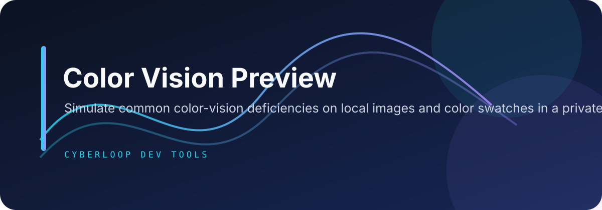

<div align="center">


<a href="https://github.com/CyberLoop-dev/color-vision-preview">
  
</a>

<p><strong>Simulate common color-vision deficiencies on local images and color swatches in a private browser workspace.</strong></p>

[](LICENSE)
[](https://github.com/CyberLoop-dev/color-vision-preview)
[](https://github.com/CyberLoop-dev/color-vision-preview/stargazers)
[](https://github.com/CyberLoop-dev/color-vision-preview/commits/main)



</div>

## ✨ Overview

Simulate common color-vision deficiencies on local images and color swatches in a private browser workspace. **Color Vision Preview** is a small, focused Node.js + browser JavaScript project designed to be easy to inspect, run, and extend. It works locally and keeps the workflow straightforward.

## 🚀 Features

- ✨ 🖼️ Load an image directly into the browser canvas.
- ✨ 🎛️ Preview protanopia, deuteranopia, tritanopia, grayscale, and normal modes.
- ✨ 🎨 Compare a built-in color palette under the selected simulation.
- ✨ 📥 Export the transformed canvas as PNG; no upload endpoint exists.

## 🖥️ Demo

Run `npm start`, open `http://127.0.0.1:4173`, choose an image, and switch simulation modes. The sample palette updates with the image.

## ⚡ Quick Start

```bash
npm start
```

See the command-specific notes below if the project needs an input file or a browser tab.

## 🧰 Tech Stack

- **Primary language:** Node.js + browser JavaScript
- **Runtime:** Free, locally installed tooling
- **Dependencies:** Minimal; see the manifest in this repository

## 📁 Folder Structure

```text
color-vision-preview/
├── assets/
│   └── overview.svg
├── README.md
├── LICENSE
└── source files and project manifest
```

## 🗺️ Roadmap

- [ ] Add user-defined palette swatches.
- [ ] Add side-by-side original and simulated views.
- [ ] Add keyboard-accessible preset controls.

## 🤝 Contributing

Issues and pull requests are welcome. Keep changes focused, document behavior, and add tests for new parsing or transformation rules.

## 📄 License

Released under the [MIT License](LICENSE).

<div align="center">
  
</div>
